# Themarr

<p align="center">
  
</p>

Themarr is a web app for managing theme songs for TV shows and movies.  
It supports **Plex and Jellyfin libraries side-by-side** and can save themes as local `theme.mp3` files next to your media.

Theme download sources in the web UI:

- **Plex** (provider theme, where available)
- **ThemerrDB** (matched via IMDB/TMDB/TVDB IDs for Plex and Jellyfin items)
- **YouTube** (via `yt-dlp`)

You can also upload custom MP3 files and copy existing local themes between items.

## Features

- **Dual media-server support**  
  Browse **Plex Libraries** and **Jellyfin Libraries** in separate sidebar groups in one UI.

- **Three download sources**  
  Download from **Plex** (Plex items), **ThemerrDB** (Plex + Jellyfin), or **YouTube**.
  YouTube downloads support optional start/stop trim times in the modal.

- **Audio normalization**  
  Newly downloaded themes are normalized to **-24 LUFS** with FFmpeg `loudnorm` to reduce volume jumps between items.

- **Automatic ID3 metadata tagging**  
  Theme files are tagged with title/album/genre metadata, embed available artwork, and normalize album names by removing trailing year suffixes like `"(2020)"`.

- **Upload and copy local themes**  
  Upload custom MP3 files or copy `theme.mp3` between items/libraries.

- **Bulk actions**  
  Multi-select Plex items to bulk download themes, or bulk post-process existing local `theme.mp3` files (normalize audio + add missing metadata without overwriting existing tags).

- **Plex + Jellyfin webhooks**  
  Automatically process new library items from webhook events.

- **Pushover notifications (optional)**  
  Receive push notifications when downloads complete. Notifications can be independently enabled/disabled for webhook-triggered downloads, webhook failures, and UI-triggered downloads using `NOTIFY_ON_WEBHOOK_DOWNLOAD`, `NOTIFY_ON_WEBHOOK_FAILURE`, and `NOTIFY_ON_UI_DOWNLOAD`.

- **Automatic metadata refresh**  
  After a theme is downloaded, uploaded, or copied, Themarr automatically triggers a metadata refresh on the connected Plex and/or Jellyfin server so the theme is picked up without manual intervention. When both providers are configured, a cross-provider refresh is attempted for the same media item on the other server as well.

- **Agent API + MCP server**
  Agents can find shows/movies with missing local themes, inspect available sources, search YouTube, and download a chosen theme with optional trimming. Existing themes are preserved unless replacement is explicitly requested. See [Agent access](#agent-access-api--mcp).

- **Dark/light UI + poster/list views**  
  Configurable defaults with in-browser preference switching.

### Gallery

Each scene is available in matching dark and light variants.

| Scene | Dark | Light |
|---|---|---|
| Login screen |  | 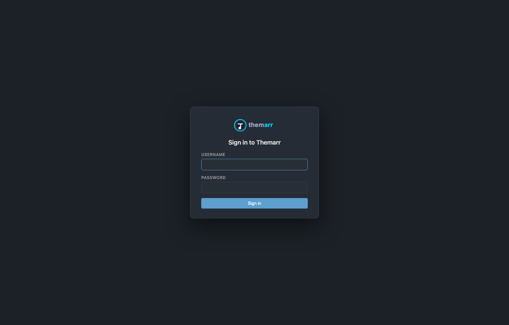 |
| Welcome screen |  | 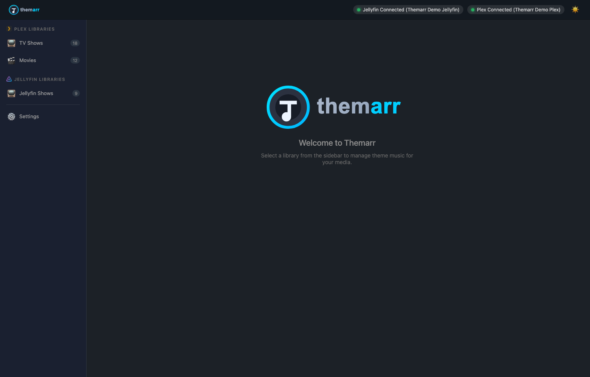 |
| Poster view | 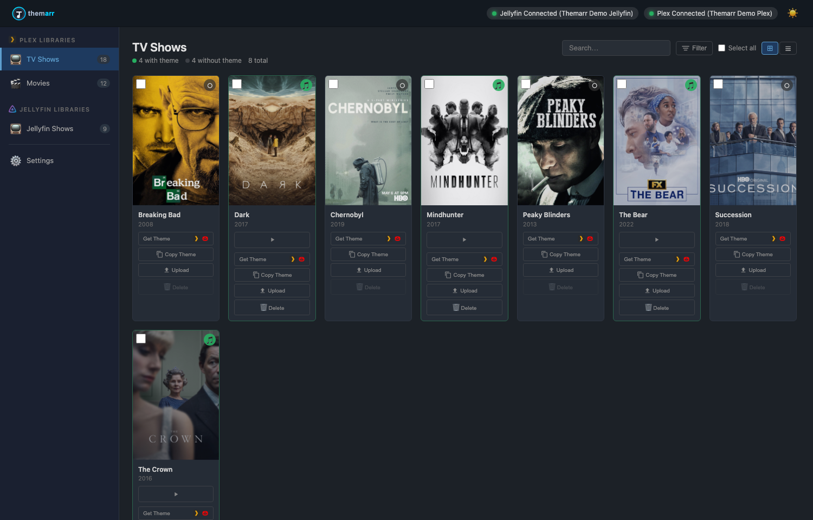 | 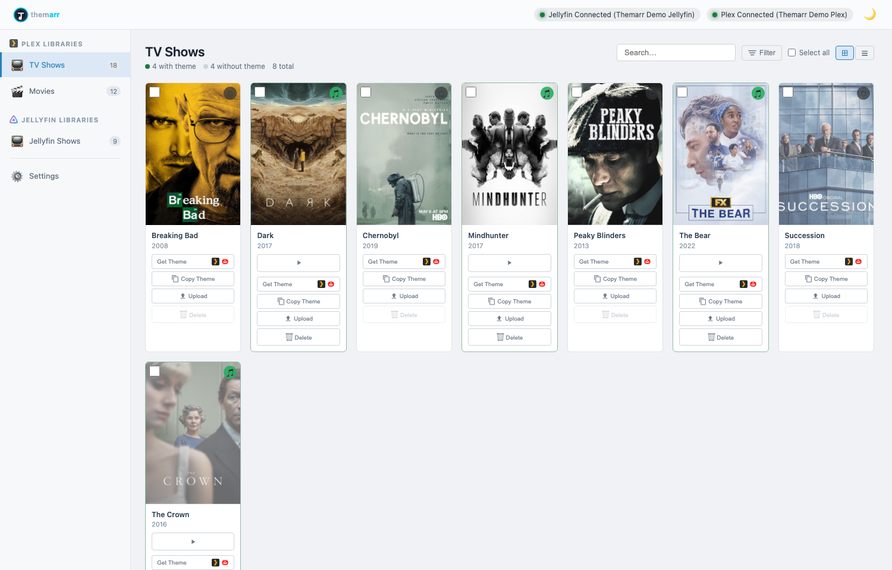 |
| List view | 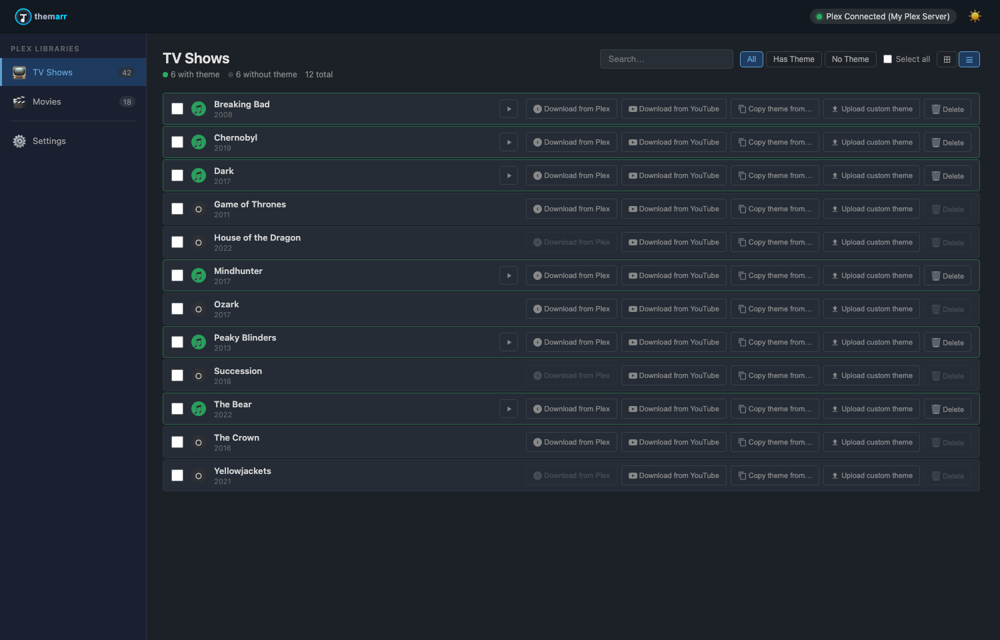 | 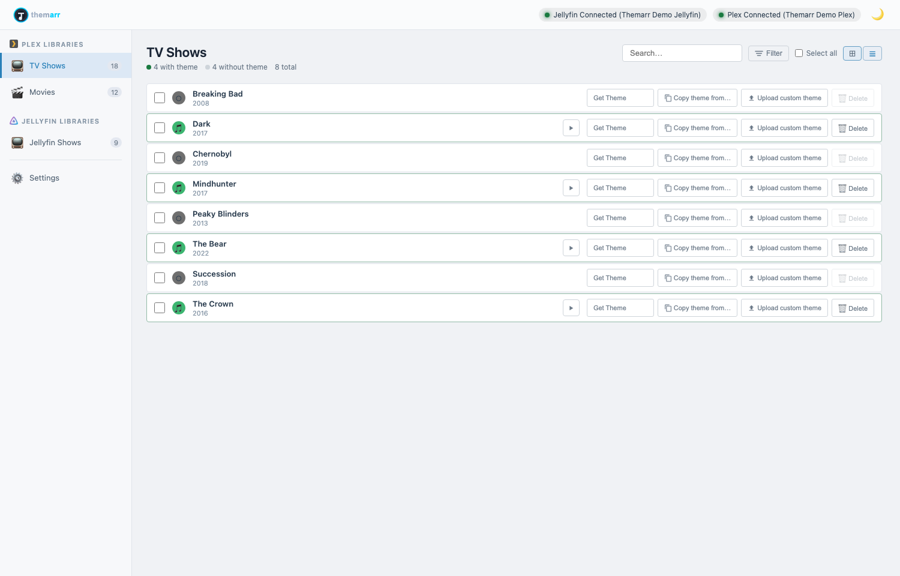 |
| YouTube downloader (trim start/stop) | 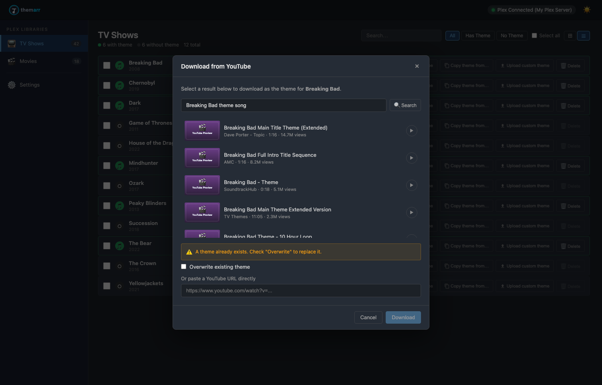 | 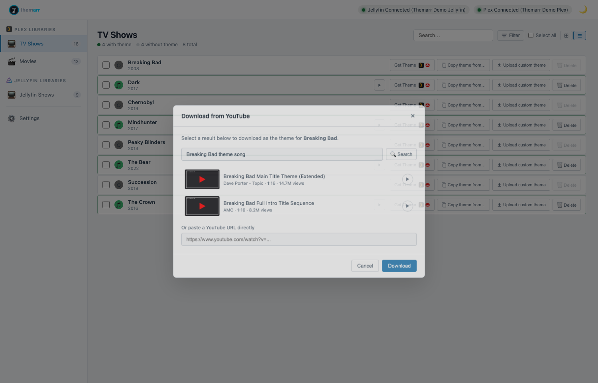 |
| Copy theme | 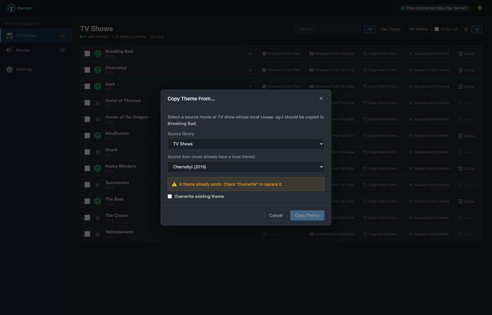 | 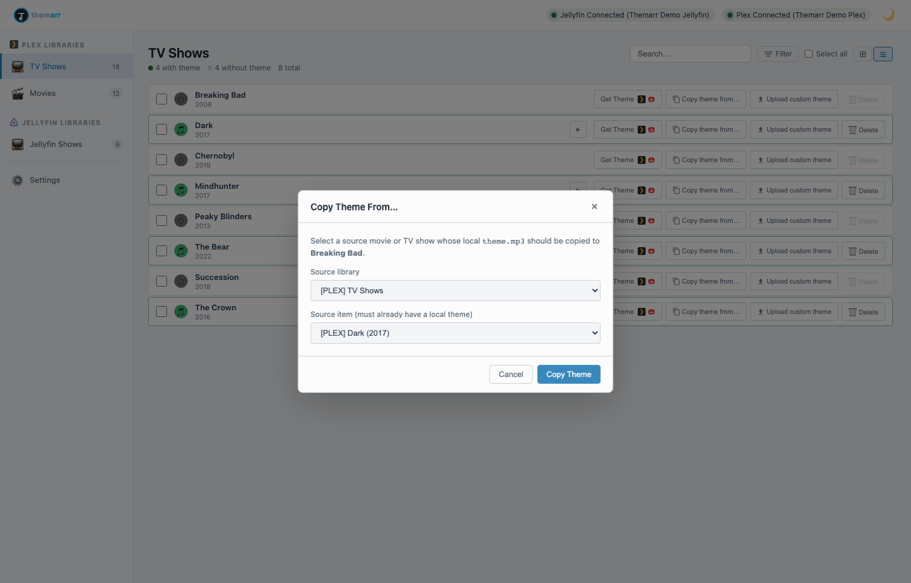 |
| Plex download | 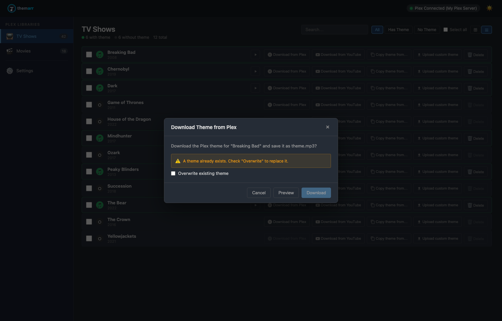 | 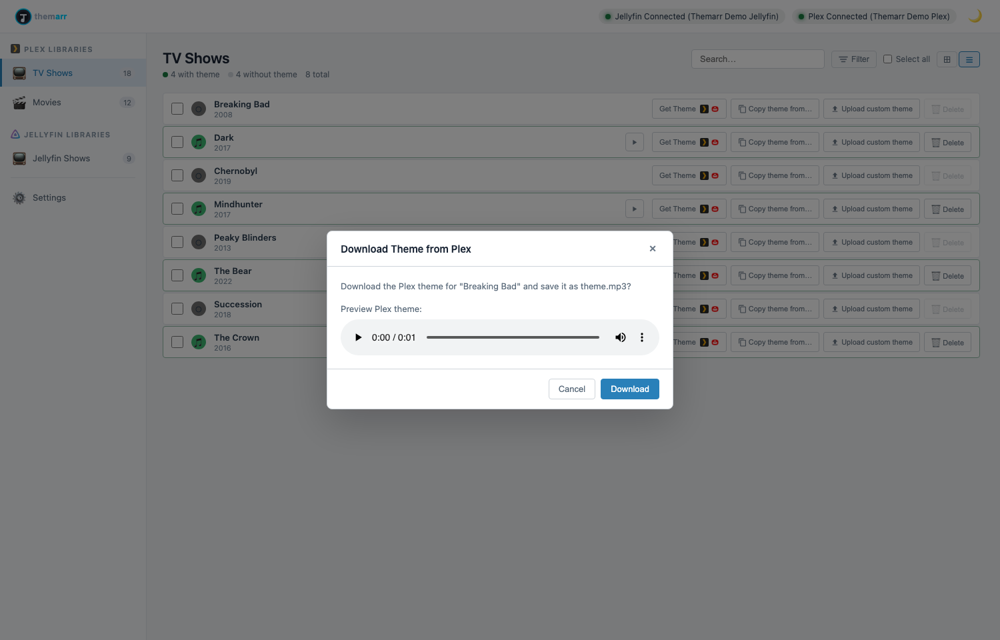 |
| Settings (API/MCP disabled until configured) | 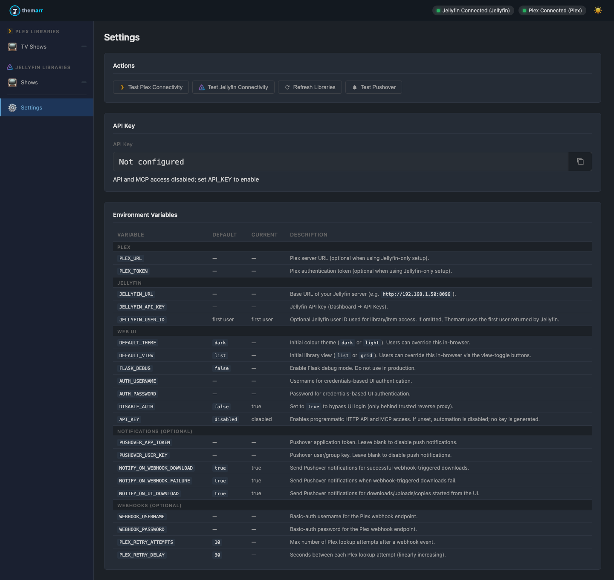 | 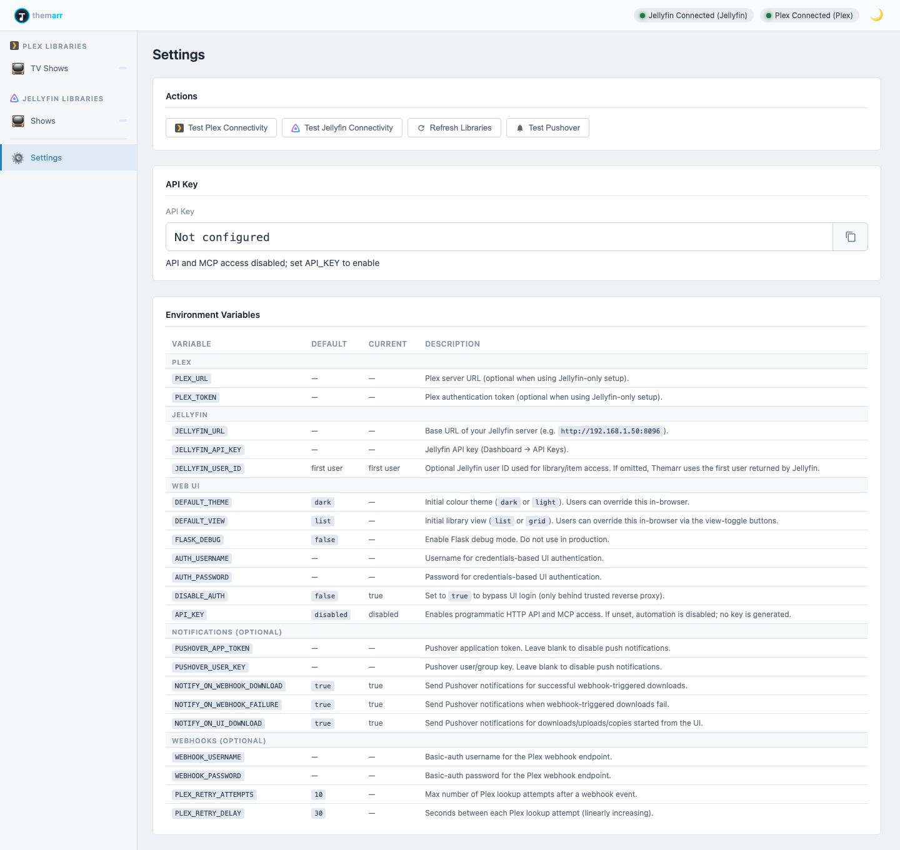 |

## Quick start (Docker Compose)

Themarr is designed to run with the `docker-compose.yml` in this repository.

1. Copy the example environment file:

   ```bash
   cp .env.example .env
   ```

2. Edit `.env` and set your Plex and/or Jellyfin settings.

3. Start Themarr:

   ```bash
   docker compose up --build
   ```

4. Open:

   ```text
   http://localhost:8080
   ```

### Important: path mounts must match your media-server container paths

Themarr writes `theme.mp3` files directly to the media library on disk. To locate the right folder, it uses the file-system path that Plex or Jellyfin reports for each item — so Themarr's container must mount the **same host directories** at the **same container paths** that your media-server container uses.

Edit the `volumes` section of `docker-compose.yml` to match your actual library paths:

```yaml
volumes:
  # Use the SAME path you use to mount your media in the plex/jellyfin container so that the absolute path
  # inside Themarr matches the path reported by your Plex/Jellyfin container.
  - /<path to tvshows>:/tvshows
  - /<path to movies>:/movies
```

If your Plex or Jellyfin container mounts `/data/media/tv`, use `/data/media/tv:/data/media/tv` here.

### Deployment templates and upgrading an existing installation

- [docker-compose.yml](docker-compose.yml) builds the current source, passes
  `API_KEY` from `.env`, and exposes the Web UI, API and `/mcp` together on port 8080.
- [kubernetes-deployment.yaml](kubernetes-deployment.yaml) includes a ConfigMap,
  Deployment, Service and optional TLS Ingress. It uses existing `movies-pvc` and
  `tvshows-pvc` claims mounted at `/movies` and `/tv`, and references
  `themarr-secrets` rather than embedding credentials.

For Docker, set a stable `API_KEY` in your private `.env`, configure provider
credentials and media mounts, then run `docker compose up -d --build`.
Keep the image's default startup command; an old Gunicorn command serving only
`app.web_app:app` does not expose `/mcp`.

For Kubernetes, merge these changes into your existing deployment rather than
blindly applying the whole example:

1. Use an image built from this MCP-enabled source. Build and push it to your own
   registry, or select a published release that includes this feature; an older
   `latest` image will not gain MCP merely from a manifest change.
2. Add a stable `API_KEY` to your existing Secret through your normal secret
   management process and reference it from the container:

   ```yaml
   - name: API_KEY
     valueFrom:
       secretKeyRef:
         name: themarr-secrets
         key: API_KEY
   ```

3. Preserve your existing namespace, Deployment selector, Service selector, PVCs,
   media paths and UID. The example uses namespace `themarr`; change it to your
   existing namespace (for example `mediaplayback`). Do not change an existing
   Deployment's immutable selector. PVCs and Secrets must exist in that namespace.
4. Remove any old startup override, or use
   `uvicorn app.http_server:app --host 0.0.0.0 --port 8080 --workers 1`.
   No MCP-specific port, sidecar or additional server environment variable is needed.
5. Keep `/health` probes. Forward `/mcp` through your existing TLS ingress on the
   same Service port as the UI, preserve the API-key header, and allow at least
   120 seconds for downloads. The example's NGINX ingress uses 180-second timeouts;
   adapt its class/annotations, hostname and TLS Secret for your controller.

The example defaults to `DISABLE_AUTH=false` and requires `AUTH_USERNAME` and
`AUTH_PASSWORD` Secret keys for UI login. If your trusted reverse proxy already
enforces UI authentication, you may keep your existing `DISABLE_AUTH=true`;
**MCP still requires the API key**. Optional Pushover Secret keys are supported.
Do not commit populated Secret manifests or environment files.

## Agent access (API + MCP)

Use a stable `API_KEY` in `.env` for automation, then rebuild/restart Themarr.
HTTP endpoints accept `Authorization: Bearer <API_KEY>` or `X-Themarr-Api-Key`.
Without a non-empty `API_KEY`, programmatic API and MCP access are disabled
(HTTP 503); no key is generated. Agent routes require an API key even with
`DISABLE_AUTH=true`. Existing Web UI session/reverse-proxy workflows and separately
authenticated webhooks remain available without `API_KEY`. Never put a key in a URL.
Use HTTPS through a trusted reverse proxy for remote access.

### HTTP API

The agent API is available on the existing web port; no additional port is needed.

| Method | Endpoint | Purpose |
|---|---|---|
| GET | `/api/agent/v1/capabilities` | Discover routes, sources, limits and theme-state semantics |
| GET | `/api/libraries` | List Plex/Jellyfin libraries with `provider` and `id` |
| GET | `/api/agent/v1/libraries/{provider}/{library_id}/items` | Search/filter a library and get local-theme summary counts |
| GET | `/api/agent/v1/items/{provider}/{item_id}/options` | Fresh local theme check, external IDs and available source options |
| GET | `/api/youtube/search?q=...&limit=5` | Search YouTube candidates (up to 10 results) |
| POST | `/api/agent/v1/items/{provider}/{item_id}/download` | Download from `plex`, `themerrdb` or `youtube` |
| GET | `/api/cache/status` | Check library/theme hydration progress |

Item-list parameters: `q` (case-insensitive title search, maximum 200 characters),
`theme_status=all|present|missing`, `type=all|show|movie`, `page` (starts at 1),
and `page_size` (1–100, default 50). The response contains `items`, `pagination`
(`page`, `page_size`, `total`, `has_more`), and `summary` counts for the whole library.
Filtering happens before pagination. Each item includes its provider, ID, title,
year, external IDs, and local/Plex/ThemerrDB theme flags.

**Present/missing means a non-empty local `theme.mp3`**, not whether a remote source
exists. Library lists are cached; use item options for a fresh local-file check.
Remote source availability does not guarantee that a video is still playable;
Plex may also report an existing local theme as its source. Source options explicitly
report these caveats. A missing local path means the media mounts must be corrected
before a download can succeed.

Example workflow (replace library/item IDs with values returned by discovery):

```bash
# API_KEY should already be exported in your shell; never hardcode it in scripts.
curl --fail-with-body -H "Authorization: Bearer $API_KEY" \
  http://localhost:8080/api/libraries

curl --fail-with-body -H "Authorization: Bearer $API_KEY" \
  'http://localhost:8080/api/agent/v1/libraries/plex/1/items?theme_status=missing&q=Example'

curl --fail-with-body -H "Authorization: Bearer $API_KEY" \
  http://localhost:8080/api/agent/v1/items/plex/123/options

curl --fail-with-body -X POST \
  -H "Authorization: Bearer $API_KEY" -H 'Content-Type: application/json' \
  -d '{"source":"youtube","url":"https://www.youtube.com/watch?v=VIDEO_ID","start_time":"0:10","end_time":"1:10"}' \
  http://localhost:8080/api/agent/v1/items/plex/123/download
```

For ThemerrDB use `{"source":"themerrdb"}`; for Plex use `{"source":"plex"}`
(Plex items only). `overwrite` defaults to `false` and must be a JSON boolean.
YouTube accepts optional `start_time`/`end_time` as seconds or `MM:SS`/`HH:MM:SS`;
URL/trim fields are invalid for other sources.
An existing theme returns HTTP **409** unless `"overwrite":true` is explicitly supplied.
Invalid input returns **400**, unauthenticated requests **401**, and source/server
failures return non-success responses with a JSON `error`.

Downloads are synchronous and reuse the UI's validation, audio normalization,
metadata tagging, cache updates, notifications and media-server refresh behavior.
After a timeout, check theme options before retrying: the original download may
still be running. Only download content you have permission to use.

### MCP tools

Themarr automatically hosts a **Streamable HTTP MCP server** at
`https://your-themarr-host/mcp`, on the same port as the Web UI, in Docker and
Kubernetes. No sidecar, extra port or subprocess configuration is needed.
The container starts the combined HTTP application; custom launch commands must
use `uvicorn app.http_server:app --host 0.0.0.0 --port 8080 --workers 1`.

**Every MCP request requires a valid API key**, using
`Authorization: Bearer <API_KEY>` or `X-Themarr-Api-Key`.
UI sessions, query-string keys and `DISABLE_AUTH=true` do **not** bypass MCP
authentication. Set `API_KEY` to enable access; if unset or blank, `/mcp` returns
HTTP 503 and no key is generated.
Use HTTPS for remote connections. MCP requests with a cross-origin `Origin`
header are rejected; non-browser MCP clients usually omit that header.

Portable MCP configuration for VS Code/Copilot: save this as workspace-root
`.mcp.json`, or in `$COPILOT_HOME/mcp-config.json` (default
`~/.copilot/mcp-config.json`). Supply `THEMARR_API_KEY` in the environment of the
host running the MCP client; for remote workspaces this means the remote host or
container, not an unrelated local terminal. Do not commit the actual key.

```json
{
  "mcpServers": {
    "themarr": {
      "type": "http",
      "url": "https://your-themarr-host/mcp",
      "headers": {
        "X-Themarr-Api-Key": "${THEMARR_API_KEY}"
      }
    }
  }
}
```

This uses the [portable configuration format](https://code.visualstudio.com/docs/agents/reference/mcp-configuration).
Portable configurations do not support `inputs`, `${input:...}` or `envFile`.
`THEMARR_API_KEY` is a client-side variable containing the server's `API_KEY`;
it is not an additional Themarr server setting.

Configure your reverse proxy to forward `/mcp`, preserve authentication headers,
and allow at least 120 seconds for download requests. The endpoint is stateless,
so no session-affinity configuration is needed. Keep a single application worker
per container to preserve Themarr's in-memory cache and ephemeral UI sessions.

Available tools:

- `list_libraries`
- `list_items` (title query, local-theme/type filters, pagination)
- `get_theme_options`
- `search_youtube`
- `download_theme` (explicit source, optional YouTube URL/trim, overwrite off by default)
- `get_capabilities`
- `get_cache_status`

Agents should discover the exact provider/item ID, inspect options, and obtain
user approval before downloading or replacing a theme. Titles and search results
are untrusted data. The download tool is marked as mutating/potentially destructive;
the MCP host's approval policy controls user confirmation.
Deletion, settings changes and bulk mutation are deliberately not exposed as MCP tools.

#### Optional stdio bridge

Hosts that only support stdio can still use the HTTP API bridge.
For a local Docker deployment, configure your MCP host to run:

```bash
docker exec -i themarr python -m app.mcp_server --url http://127.0.0.1:8080
```

Set an explicit `API_KEY` in the container environment first; the bridge inherits
it, so no secret is needed in the MCP configuration. Do **not** use `docker exec -t`:
a terminal interferes with the stdio protocol.

Portable stdio MCP configuration:

```json
{
  "mcpServers": {
    "themarr": {
      "type": "stdio",
      "command": "docker",
      "args": ["exec", "-i", "themarr", "python", "-m", "app.mcp_server", "--url", "http://127.0.0.1:8080"]
    }
  }
}
```

For a stdio bridge to Themarr running on another machine, install `requirements.txt` in a local
Python **3.11+** environment, run from the repository root, and configure your host
to launch `python -m app.mcp_server --url https://your-themarr-host`.
Supply `API_KEY` through the host's secure environment/secret input, not a
command-line argument or committed configuration. The base URL may include a
reverse-proxy path prefix. The bridge does not follow HTTP redirects; configure
the final URL. Its HTTP timeouts are 5 seconds to connect and 110 seconds to read;
configure the MCP host's tool timeout to at least 120 seconds.

## Environment variables

| Variable | Required | Default | Description |
|---|---|---|---|
| `PLEX_URL` | No* | — | Plex server URL (example: `http://192.168.1.100:32400`) |
| `PLEX_TOKEN` | No* | — | Plex API token |
| `JELLYFIN_URL` | No* | — | Jellyfin server URL (example: `http://192.168.1.50:8096`) |
| `JELLYFIN_API_KEY` | No* | — | Jellyfin API key |
| `JELLYFIN_USER_ID` | No | first Jellyfin user | Optional explicit Jellyfin user ID |
| `FLASK_DEBUG` | No | `false` | Enables Flask debug mode |
| `DEFAULT_THEME` | No | `dark` | Default UI theme: `dark` or `light` |
| `DEFAULT_VIEW` | No | `list` | Default library view: `list` or `grid` |
| `AUTH_USERNAME` | No | — | Username for the login screen. Set together with `AUTH_PASSWORD` when `DISABLE_AUTH=false`. |
| `AUTH_PASSWORD` | No | — | Password for the login screen (used with `AUTH_USERNAME` when `DISABLE_AUTH=false`). |
| `DISABLE_AUTH` | No | `false` | Set to `true` to disable all UI authentication. Only use this when a trusted reverse proxy already handles auth (see [Disable auth](#disable-auth-reverse-proxy)). |
| `API_KEY` | For API/MCP | disabled | Explicit key enabling programmatic HTTP API and MCP access. Unset/blank disables automation; no key is generated. |
| `WEBHOOK_USERNAME` | No | — | Optional Basic Auth username for Plex/Jellyfin webhook endpoints |
| `WEBHOOK_PASSWORD` | No | — | Optional Basic Auth password for Plex/Jellyfin webhook endpoints |
| `PUSHOVER_APP_TOKEN` | No | — | Pushover app token (required together with `PUSHOVER_USER_KEY`) |
| `PUSHOVER_USER_KEY` | No | — | Pushover user/group key (required together with `PUSHOVER_APP_TOKEN`) |
| `NOTIFY_ON_WEBHOOK_DOWNLOAD` | No | `true` | Send a Pushover notification when a theme is auto-downloaded via a Plex/Jellyfin webhook |
| `NOTIFY_ON_WEBHOOK_FAILURE` | No | `true` | Send a Pushover notification when a webhook-triggered theme download fails |
| `NOTIFY_ON_UI_DOWNLOAD` | No | `true` | Send a Pushover notification when a theme is downloaded, uploaded, or copied through the web UI |

\* Configure at least one provider (Plex and/or Jellyfin).

## Authentication

Themarr has two Web UI authentication modes plus always-on API key support:

### Credentials (recommended)

Set both `AUTH_USERNAME` and `AUTH_PASSWORD` in your `.env`.  
A login screen is shown on first visit asking for username and password.

```env
AUTH_USERNAME=admin
AUTH_PASSWORD=yourpassword
```

### Missing credentials while auth is enabled

If `DISABLE_AUTH=false` and either `AUTH_USERNAME` or `AUTH_PASSWORD` is missing, the Web UI only shows a warning page until both are set.

### API key (automation)

`API_KEY` is independent from UI auth mode and is intended for scripts, API clients, and webhook callers.
If `API_KEY` is unset or blank, programmatic HTTP API and MCP access are disabled.
No key is generated. Web UI login and session-based operations remain available.
Configured keys can be viewed on the authenticated Settings page.

### Disable auth (reverse-proxy)

Set `DISABLE_AUTH=true` to bypass all UI authentication.  
Use this **only** when a trusted reverse proxy (e.g. Authelia, Authentik, nginx Basic Auth) already handles authentication in front of Themarr.

```env
DISABLE_AUTH=true
```

> **Note:** Agent API and MCP access always require an explicitly configured key,
> regardless of the UI auth mode. Webhooks retain their separate authentication.

## Source behavior by provider

| Action | Plex items | Jellyfin items |
|---|---|---|
| Download from Plex source | ✅ | ❌ |
| Preview Plex source theme | ✅ | ❌ |
| Download from ThemerrDB | ✅ (via IMDB/TMDB/TVDB) | ✅ (via IMDB/TMDB/TVDB) |
| Preview ThemerrDB source theme | ✅ | ✅ |
| Download from YouTube | ✅ | ✅ |
| Upload local MP3 | ✅ | ✅ |
| Copy local theme | ✅ | ✅ |
| Delete local theme | ✅ | ✅ |

## Webhooks

### Plex Webhooks
Themarr can process Plex webhook events for newly added library items.

#### Setup

1. In Plex, go to **Settings > Webhooks**
2. Click **Add Webhook**
3. Enter your Themarr webhook URL:
   ```
   http://<themarr-host>:8080/api/webhooks/plex
   ```
4. Click **Save**

### Jellyfin Webhooks

Themarr can process Jellyfin webhook events for newly added library items.

Unlike Plex webhooks, Jellyfin webhook automation only downloads from **ThemerrDB**:

- If local `theme.mp3` already exists, Themarr skips the item.
- If ThemerrDB has no matching theme for the item, nothing is downloaded.

#### Setup

1. In Jellyfin, install/enable the **Webhook** plugin.
2. In the Webhook plugin UI, create a new generic webhook destination.
3. Set the destination URL to:
   ```
   http://<themarr-host>:8080/api/webhooks/jellyfin
   ```
4. In the destination's event/notification checkboxes, enable **Item Added**.
5. Keep the request body format as JSON and leave the payload template at its default plugin values (no custom template required).
6. Save and test the webhook.

## Optional webhook hardening

- Reuse `WEBHOOK_USERNAME` + `WEBHOOK_PASSWORD` to protect both Plex and Jellyfin webhook endpoints with Basic Auth.

## License

This project is licensed under the [MIT License](LICENSE).
